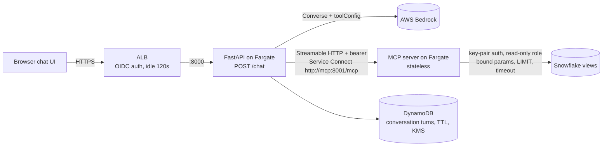

# Claims data assistant

Ask natural-language questions about healthcare provider and claims data in Snowflake. A chat UI calls FastAPI, which runs a Bedrock Converse tool-use loop; tools live on a separate, long-running MCP server that executes only predefined, parameterized, read-only SQL.

> **Status: development scaffold, not production-ready.** It becomes deployable once authentication (ALB OIDC), DynamoDB conversation storage, real schema mappings, Snowflake key-pair credentials, and environment-specific Terraform values are in place. See [What remains](#what-remains).

## Architecture



One chat turn:

1. UI posts `{message, conversation_id}` to `/chat`. FastAPI validates it, resolves the user from the ALB-signed header, and starts a 90-second budget.
2. The agent loads prior text turns (owner-checked), lists tools from the MCP server, and keeps only allowlisted ones.
3. Bedrock returns `toolUse`. The agent rejects anything not allowlisted, then calls the MCP server, reusing one MCP session for the turn.
4. The MCP server checks the bearer token, validates arguments (NPI check digit, ISO dates, range cap), binds them into a fixed SQL template, enforces row limits and statement timeouts, suppresses small patient counts, and returns JSON.
5. The agent sends `toolResult` blocks back to Bedrock, repeating up to `MAX_TOOL_ROUNDS` times, and returns the final text plus a tool trail (name, status, duration only).

## Quick start (no credentials)

```bash
cp .env.example .env          # defaults: MOCK_BEDROCK=true, MOCK_SNOWFLAKE=true
docker compose up --build
open http://localhost:8000
```

Ask *"Summarize claims for provider 1234567893 in 2025"*. The fake model emits real `toolUse` blocks, the MCP server runs the real SQL templates against seeded SQLite, and the answer shows a lookup trail. Answers start with `[Mock model]`.

Sample NPIs in the mock data: `1234567893`, `1003000019`, `1003000027`, and `1003000035`. The last one has few patients, so its patient count is suppressed.

### Without Docker

```bash
make setup                    # venv + editable install with dev extras, creates .env
make run-mcp                  # terminal 1: MCP server on :8001
make run-api                  # terminal 2: API + UI on :8000
```

## API

`POST /chat`

```json
{"message": "How many claims did provider 1234567893 submit in 2025?", "conversation_id": null}
```

```json
{
  "answer": "[Mock model] Provider 1234567893 had 51 claims from 2025-01-01 to 2025-12-31, covering 25 distinct patients. Billed $68,722.26, paid $31,319.01.",
  "conversation_id": "5d8f2c3e-0a47-4a8e-9a1b-2f0c6c7e9b10",
  "request_id": "9b1e6f0a-3c2d-4e5f-8a7b-1c2d3e4f5a6b",
  "tool_calls": [{"name": "get_provider_claim_summary", "status": "success", "duration_ms": 142}]
}
```

Errors return `{"error": {"code", "message"}, "request_id"}` with a safe message, and validation errors never echo input. The mapped statuses are 401 for unauthenticated, 422 for an invalid request, 503 when the service is busy, throttled, or the tools are down, and 504 when the request runs out of time.

`GET /health` is liveness for the ALB. `GET /ready` checks config and that tools can be listed.

## Commands

| Task | Command |
| --- | --- |
| Install | `make setup` |
| Lint / format check | `make lint` |
| Type check | `make typecheck` |
| Unit + API tests | `make test` |
| MCP over HTTP integration tests | `make test-integration` |
| Run locally | `make run-mcp`, `make run-api` |
| Compose stack | `make up` |
| Build images | `make build` (targets `api` and `mcp`) |
| Evals against a running API | `make evals` (or `BASE_URL=https://... make evals`) |

## Repository map

```
app/            FastAPI service: routes, auth, agent loop, MCP client, conversation store, UI
mcp_server/     MCP service: tools, validation, schema mapping, SQL templates, Snowflake + SQLite clients
tests/          unit, API, and integration tests (tests/support/fakes.py has the doubles)
evals/          questions with expected tool calls; scripts/run_evals.py runs them
infra/terraform ALB, ECS Fargate x2, Service Connect, IAM, DynamoDB, autoscaling
infra/snowflake read-only role, secure views, warehouse, key-pair service user
```

## Connecting real services

**Snowflake schema.** Edit `mcp_server/schema_mapping.py` defaults, or provide `SCHEMA_MAPPING_PATH` / `SCHEMA_MAPPING_JSON` (see `schema_mapping.example.json`). Confirm with data owners whether "submitted" means submission date or service date, and whether claims attribute to the rendering or billing NPI. If the real model needs joins, lookups, or claim-line rollups, change the templates in `mcp_server/queries.py`; the safety tests will check them. Then run `infra/snowflake/setup_readonly_role.sql` after replacing the object names.

**Snowflake auth.** Use key-pair auth for a `TYPE = SERVICE` user. Put the PEM in Secrets Manager and inject it as `SNOWFLAKE_PRIVATE_KEY_PEM`, or set `SNOWFLAKE_PRIVATE_KEY_PATH` locally. Every query carries a JSON `QUERY_TAG` so it can be traced in `QUERY_HISTORY`.

**Bedrock.** Set `MOCK_BEDROCK=false` and `BEDROCK_MODEL_ID` to a model or inference profile your account can use in `AWS_REGION`. Locally, credentials come from your AWS profile; in ECS they come from the task role. Disable model invocation logging, or route it only to a PHI-approved destination.

**Adding a tool.** Write the function in `mcp_server/tools/`, put its SQL in `queries.py`, register it in `mcp_server/server.py`, add its name to `TOOL_ALLOWLIST`, add a label in `app/static/app.js`, and add tests and eval questions.

## Deploying to AWS

1. Create two Secrets Manager secrets: a random MCP bearer token and the Snowflake private key PEM.
2. Build and push images: `make build`, then tag and push both to ECR.
3. `cd infra/terraform`, copy `example.tfvars` to `<env>.tfvars`, and fill in the VPC, subnets, certificate, images, secret ARNs, Bedrock ARNs, Snowflake settings, and `oidc` for staging/production.
4. Run `terraform init` (configure a remote backend first), then `terraform apply -var-file=<env>.tfvars`.
5. Point DNS at the `alb_dns_name` output.

The ALB forwards HTTPS to FastAPI tasks on port 8000, with `/health` as the target-group check. Autoscaling tracks ALB requests per target, because chat requests are I/O-bound and CPU is a poor signal. The MCP service is reachable only from API tasks via Service Connect at `http://mcp:8001/mcp`. `REQUEST_TIMEOUT_SECONDS` is set 15 seconds under the ALB idle timeout.

Private subnets need egress to Bedrock, DynamoDB, Secrets Manager, ECR, CloudWatch, and Snowflake. VPC endpoints and Snowflake PrivateLink are preferable to NAT for PHI workloads.

## Security and compliance notes

These are implemented:
- **SQL is fixed and read-only.** The model can't submit SQL. Templates are SELECT-only and identifiers are validated, and both are checked at render time and by tests. User values travel only through bind parameters, with row limits and statement timeouts in place.
- **Tool access is enforced in code.** The allowlist applies at discovery and again at call time. Tool output is treated as untrusted data in the system prompt.
- **Services authenticate to each other.** API to MCP calls carry a bearer token checked in constant time, on top of security groups.
- **Logs and responses carry no PHI.** Logs never contain messages, answers, arguments, or rows; they record tool names, statuses, durations, and request IDs. Error details stay server-side.
- **Conversation storage is minimal.** It holds user and assistant text only, never tool results. Conversations are owner-bound, TTL'd, and KMS-encrypted in DynamoDB.
- **Data returned is minimized.** No member identifiers are returned, and patient counts under the threshold are suppressed. Claim counts are not suppressed, so confirm that policy with your privacy office.
- **Production config is checked at startup.** The app refuses to start in production with `AUTH_MODE=none`, in-memory storage, the mock model, a missing MCP token, or wildcard CORS.

Decided but not implemented:
- **Authorization is not per-user.** Every authenticated user can query every provider through the single service role. The user's `sub` reaches the agent, so per-user scoping can be added at the tool layer or with Snowflake row access policies.
- **There is no per-user rate limiting.** Global concurrency is capped per task. Add AWS WAF rate rules on the ALB if needed.

## Fake NPI data for RDS PostgreSQL

`scripts/generate_fake_npi_data.py` writes synthetic `providers.csv` and `claims.csv`
(default 100 providers, 10,000 claims, 2024-2025) to `data/fake/`, which git ignores.
All names, members, and amounts are invented. NPIs pass the same check-digit validation
as the MCP server but are otherwise random, so some may coincidentally match real providers.
The demo NPIs used by the UI, README, and evals are always included; `1003000035` gets only
6 claims so small-cell suppression shows up.

```bash
make fake-data                                         # or: .venv/bin/python scripts/generate_fake_npi_data.py --help
export PGHOST=<instance>.<id>.<region>.rds.amazonaws.com PGDATABASE=<db> PGUSER=<admin-user>
infra/rds/load_postgres.sh                             # creates claims_app schema, loads CSVs, prints row counts
```

`infra/rds/postgres_schema.sql` creates `claims_app.providers` and `claims_app.claims`
(foreign keys, check constraints, indexes matching the tool queries) and a read-only
`nl_assistant_reader` role. The script connects with `sslmode=require`; supply the password via
`~/.pgpass`, an RDS IAM auth token, or the psql prompt. Never commit it.

To have the MCP server query it, set `DB_BACKEND=postgres`, the `PG_*` settings in
`.env.example` (prefer `PG_SECRET_ARN` for the RDS-managed master secret, which is re-read
after rotation), and
`SCHEMA_MAPPING_JSON={"tables":{"providers":"claims_app.providers","claims":"claims_app.claims"}}`.
The same SQL templates run unchanged; sessions are TLS (`verify-full` by default), read-only,
and time-limited. For anything beyond fake data, connect as a login user granted
`nl_assistant_reader` rather than the master user.

## What remains

| Area | State |
| --- | --- |
| Mock end-to-end (UI, API, fake Bedrock, MCP, SQL) | Implemented |
| Real Bedrock client | Implemented, untested against a live account |
| Real Snowflake client | Implemented, untested against a live account; needs schema mapping |
| ALB OIDC verification | Implemented; needs IdP and listener config |
| DynamoDB store | Implemented; table in Terraform |
| Terraform | Written, not yet `terraform validate`d in a real account |
| Streaming responses (ConverseStream + SSE) | Not started; documented future path |
| Per-user authorization | Not started; see above |
